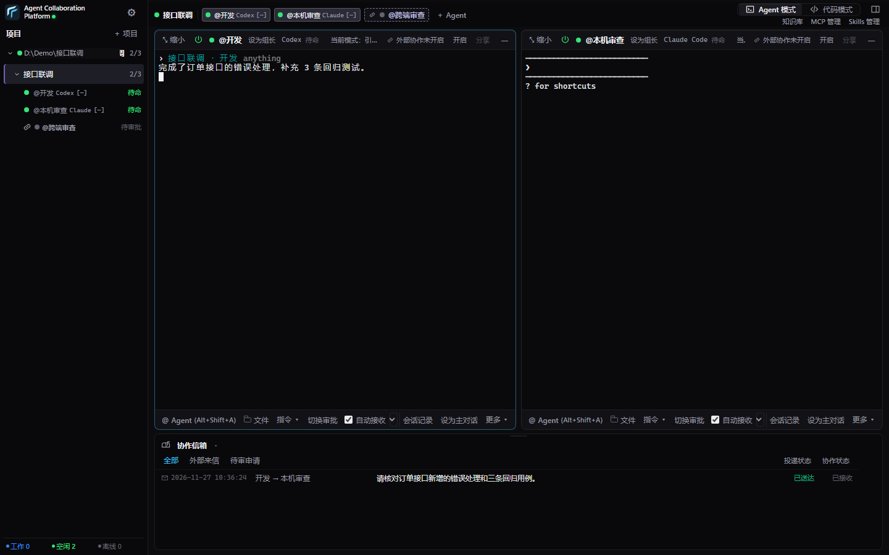

# FF.AgentCollaboration

在一个浏览器窗口里，同时使用 Codex、Claude Code、GitHub Copilot 等原生 AI 终端。你可以让一个 Agent 写代码、另一个 Agent 审查，在同一页查看改动和回复。工作台运行在 Windows 上，各 CLI 沿用自己的账号、模型和审批方式。

## 快速开始

| 你拿到的是 | 如何启动 |
| --- | --- |
| Windows 发布包 | 完整解压，双击 `启动工作台.bat`。独立部署包自带 .NET 运行时。 |
| GitHub 源码 | 安装 .NET 10 SDK，双击仓库根目录的 `start-workbench.bat`。脚本会编译并打开工作台。 |

浏览器默认打开 `http://127.0.0.1:5186`。使用期间保持控制台打开，按 `Ctrl+C` 停止。

1. **初始化。** 第一次启动时，选择数据库、话题归档和交接文档的目录。默认保存在 `workbench-data` 下。
2. **打开项目。** 点左侧「＋ 项目」选择代码目录，再点项目行上的「＋」新建话题，例如「接口联调」。
3. **打开终端。** 在话题顶部点「＋ Agent」，取名并选择一个已安装的 CLI。按提示登录后，选择新建或恢复会话。只需安装你要用的引擎。

## 工作台里可以做什么

| 功能 | 实际用法 |
| --- | --- |
| 多终端协作 | 在「Agent 模式」平铺终端，继续使用各 CLI 的斜杠命令、快捷键和审批。点左侧话题或 Agent 切换，后台终端继续运行。 |
| Agent 交接 | 在终端里提及同事并附上文件，让接收方处理后回信。「协作信箱」分别显示投递是否送达，以及任务是否已处理或回复。 |
| 文件与 Git 审查 | 切到「代码模式」，搜索和编辑项目文本，并排对照终端输出。可预览图片、视频、Markdown、PDF、Excel 和 PowerPoint，也可查看 Git 差异、暂存、提交和推送。 |
| 会话与身份 | 双击 Agent 名称，可修改名称和职责描述、保存启动模型、切换引擎或管理会话。启动模型在下次打开终端时生效。 |
| MCP 与 Skills | 在右上角打开「MCP 管理」或「Skills 管理」，查看各 CLI 的原生配置，在「平台配置」里导入工具和技能，选择使用它们的引擎。 |
| 跨电脑协作 | 分享一个 Agent，另一台工作台经你批准后即可发任务、收回复。可以按协作者设置权限和请求次数，也可以让内网电脑主动连接云端 Agent。 |
| 组队与知识库 | 组长在本话题用 `@全部` 通知成员。成员独立维护任务记录，组长从总计划查看。 |

## 试一次代码审查

在同一话题创建两个 Agent，分别叫「开发」和「审查」。在开发终端按 **Alt+Shift+A** 选中 `@审查`，或按 **Alt+Shift+F** 引用项目文件。选中后内容会插入输入行，写好再按回车。

> 把这次接口改动和测试结果发给 @审查，请它检查错误处理，完成后把结论回给我。

打开下方「协作信箱」就能跟踪这次交接。**已送达**表示消息已经进入接收终端。旁边的协作状态随 Agent 的回执更新为「正在处理」「已完成」或「已回复」。点消息可读正文和交接文档。

## 支持的 CLI

| 引擎 | 命令 | 引擎 | 命令 |
| --- | --- | --- | --- |
| OpenAI Codex | `codex` | 腾讯 CodeBuddy Code | `codebuddy` |
| GitHub Copilot CLI | `copilot` | 千问 Qwen Code | `qwen` |
| Claude Code | `claude` | 智谱 ZCode | `zcode` |
| TRAE CLI 2 | `traecli` | Qoder CLI | `qodercli` |
| OpenCode | `opencode` / `opencode2` | Cursor CLI | `agent` / `cursor-agent` |
| Google Antigravity CLI | `agy` | | |

在「工作台配置 → CLI 引擎」检测安装状态、查看版本和更新方式。会话分支、额度查询等选项按各引擎的支持情况显示。

[图文使用指南](docs/usage.md) · [开发与架构](docs/architecture.md) · [Agent 协作手册](src/FF.AgentCollaboration/Skills/ff-agent-collab/SKILL.md)

项目自有代码采用 [Apache License 2.0](LICENSE)，第三方组件保留各自许可。
