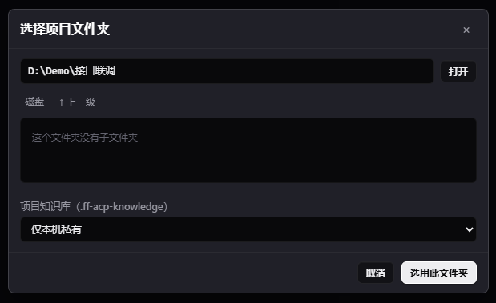
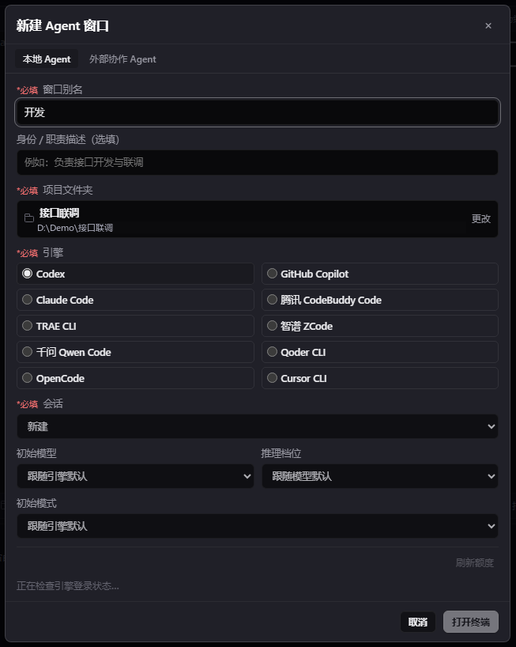

# 工作台使用指南

## 三步开始

1. 运行工作台。在左侧点「＋ 项目」，打开代码目录，然后点「选用此文件夹」。知识库默认选中「仅本机私有」，也可以手动更改。

   

2. 在项目行点「＋」创建小组。打开小组后，从「Agent → 添加 Agent」给 Agent 取名并选择 CLI。按提示登录后，选择新建或恢复会话。

   

3. 在同一个小组再建一位 Agent 负责审查。在群聊输入 `@` 选中审查 Agent，写明要核对什么，然后发送。每位收件人的接收状态显示在消息下方。

## 使用原生终端

- 在左侧展开项目和话题，点 Agent 可定位终端。电源键停止或重新打开终端，保留 Agent 配置。切换话题时，后台终端继续运行。
- 双击左侧列表里的 Agent 名称打开设置。可以填写职责、切换引擎，或在「会话管理」新建、恢复、归档会话。支持分支的 CLI 还可从历史对话继续一条独立会话。身份通过窗口的 MCP 说明传给 CLI，在线修改会随下一次成功的协作工具调用传回。
- 双击右侧终端标题可专注查看这一个 Agent，再双击恢复原来的平铺。单个终端占满右侧，两个优先上下叠放，从第三个开始横向分列。更多终端按空间排布，最多九个。打开第十个时可确认收起最早打开的窗格。收起的 Agent 继续运行和接收消息。
- 「启动模型」和推理档位在首次启动时应用。在 Agent 设置中修改后，下次启动应用一次。之后打开同一会话，模型和档位由 CLI 恢复；如果在 CLI 内换过模型，能否保留取决于该 CLI 的会话记录。
- 创建时可选择审批权限。已打开的窗格可点「切换审批」，确认后按新权限重启并恢复会话。重启会中断当前工作并清空未发送的草稿。
- 每个工作台实例保留一个活跃页面。新页面接管后，旧页会关闭或断开，Agent 终端继续运行。旧页中未保存的文件修改可作为草稿复制。

## 发送与接收

群聊按回车发送，按 Shift+回车换行。中文输入法正在组词或列表中有可选的 @ 候选时，回车先确认当前选择。

用户可在群聊输入 `@`，用方向键和回车点名一位或多位收件人。候选先列本组，各自在线的排前。选中的 `@Agent` 插入正文的光标处，删除该段文字也会取消点名。没有选中收件人的消息只进入群聊记录。可以粘贴图片、选择或拖入文件，也可以添加表情和复制正文。被点名的 Agent 根据消息内容判断是否回信，可直接在原群聊答复。

在原生终端中，`Alt+Shift+A` 搜索可联系的在线 Agent，`Alt+Shift+F` 引用项目文件路径。打开「小组 → 小组合作 → 本机小组」，勾选同项目的小组，再为每一组合作选择双方参与成员。保存后，获准成员可以互相点名。各组保留自己的群聊记录。

每个窗口可单独设置收件方式。

| 选择 | 收到消息后 |
| --- | --- |
| 自动接收 · 排队接收（默认） | Agent 待命后投递，按收件顺序处理。 |
| 自动接收 · 立即接收 | 使用引擎支持的会话队列或频道，具体执行时机由 CLI 决定。兼容模式使用终端输入行。 |
| 关闭自动接收 | 先预览，再按「立即投递」或「忽略」。 |

支持 `queue --thread` 的 Windows 原生 Codex 会直接接收本机与外部来信。自动接收和手动「立即投递」都会保留当前草稿。关闭浏览器后，工作台把来信交给该会话的原生队列安排执行。「已送达」表示原生队列已接收，任务进度看「协作状态」。若原生队列未返回确认，信箱显示「送达待核对」，以免同一条消息被执行两次。

Claude Code 与腾讯 CodeBuddy Code 支持原生频道的版本会请求启用窗口专属的 `lx_collab` 频道，具体可用性取决于 CLI 与账号策略。来信经频道通知后，Agent 调用 `receive_message` 在当前会话领取，不需要你输入命令。此方式允许你继续写草稿。若频道尚未确认且首封通知超过 15 秒仍未被领取，工作台等待安全的输入机会，沿用终端兼容投递。两条路径使用同一消息编号，只能领取一次。

其他引擎沿用兼容投递。已知的原生提示允许收件。如果你手打相同的提示并按 Home，自动收件会等你处理草稿。千问、CodeBuddy 和 Qoder 可用滚轮查看历史输出，点击原生输入行可以继续打字。

手动点击「立即投递」时，工作台可以暂存从空输入框连续键入或整段粘贴的单行草稿。光标须位于行尾，屏幕原文须与输入指纹一致。工作台确认来信提交、输入框重新空闲后，会把原文填回去，保留给你继续编辑。期间若有新输入、进入审批或终端断开，可以在当前标签页的「查看暂存草稿」取回原文。多行、带附件或无法完整核对的草稿继续留在输入框。

## 小组合作与借调

1. 本机合作打开「小组 → 小组合作 → 本机小组」，勾选同项目的小组并保存。双方默认全组参与，也可按需选择指定成员。
2. 跨端合作时，双方先设组长。提供方在组长的标题栏开启外部协作，再到「小组 → 小组合作 → 外部小组」创建邀请，填写用途，选全组或指定成员。如果只借出一位，选择该 Agent 即可。对方打开同一菜单，粘贴邀请并提交自己的小组。提供方核对申请后确认。
3. 借入方在左侧「协作小组」查看对方获批成员。借出方若指定成员，可展开该 Agent 名后的协作标记查看去向。群聊用 @ 指定收件人，输入 # 选择要在正文提到的 Agent。工作台用户也可选择对端用户直接交流。
4. 在合作面板修改参与名单、入站权限、额度、有效期、附件授权，或者暂停、解除合作。两端分别保留群聊中的任务、回信和获准附件。组长变更后由现任组长核对并保存。

两端使用 Base v1.0.2 或更新版本。通过短期 WebRTC 邀请连接时，房间到期后由对端组长复制新邀请，仍在原小组接受即可恢复连接。

**直接连接。** 提供方在「工作台配置 → 联邦节点」填写请求方能访问的 IPv4 地址或域名，可指定公网端口。安全组和防火墙需放行相应的 TCP 端口，端口映射需透传 TCP/TLS。工作台自动核对证书指纹，请求方主动建立发信与 SSE 回信连接。

**跨内网连接。** 两端在「工作台配置 → 信令服务器」填写同一个信令服务地址和公钥指纹。生成链接的一端还要填写签发密钥。新版信令服务提供 STUN 和房间专属 TURN，两端自动选择直连或中继。保存后可点「测试信令连接」核对地址与指纹。关闭网页后，运行中的工作台仍可收发。[信令部署指南](signaling.md)

**发送附件。** Agent 可以发送 TXT、Excel、PowerPoint、常用图片或 ZIP，也可以给自己已送达的消息追加附件。在工作台核对收件方与文件清单后，选择「单次授权」「永久授权此 Agent」或「拒绝」。永久授权可在该 Agent 的外部协作设置中撤销，接收方仍需允许上传。

## 从另一台电脑操作同一个工作台

如果目的是借用另一台 Windows 主机开发，可以直接在浏览器里操作那台主机的文件、Git 和终端。在主机的发布目录运行以下命令。

```powershell
.\FF.AgentCollaboration.exe workbench --open-browser --lan-http-port 5187
```

在主机浏览器打开「工作台配置 → 局域网开发」，生成配对码。在另一台电脑打开设置显示的 HTTP 地址并输入配对码。配对码十分钟内可用一次，主机可撤销配对。这个开发入口使用明文 HTTP，只应在可信私网开启。

## 引擎、版本和额度

在「工作台配置 → CLI 引擎」查看本机版本和更新方式。按提示关闭占用该引擎的终端，再点「更新」或打开「更新指南」。TRAE 和 ZCode 提供安装指南，ZCode 需选择带交互终端的独立 CLI。自行构建时可通过 `FF_ZCODE_EXE` 指向入口。

CodeBuddy 需要 Node.js 18.20.8 或更高版本。选择 TRAE 中国版 CLI 2.0 时，工作台会提示账号限制；可在安装前核对自己的账号资格。[TRAE CLI 2.0 官方说明](https://docs.trae.cn/cli_about-trae-code-cli-2)

OpenCode 支持 1.1.34 及之后的 1.x 和 2.4.2 及之后的 2.x，可在当前项目新建和恢复会话。Cursor CLI 需支持 `--plugin-dir`，历史会话在原生终端用 `/resume` 选择。两个引擎均可从新建 Agent 窗口打开官方安装指南，模型额度可在对应的服务商账号查看。[OpenCode CLI](https://opencode.ai/docs/cli/) · [Cursor CLI 参数](https://cursor.com/docs/cli/reference/parameters) · [Cursor 斜杠指令](https://cursor.com/docs/cli/reference/slash-commands)

Google Antigravity CLI 安装后，在「新建 Agent」选择对应引擎。首次登录在原生终端完成，再返回工作台新建 Agent。历史会话用终端的 `/resume` 恢复，模型额度用 `/usage` 查看。工作台为每个窗格生成独立的 `lx_collab` 配置；可用原生 `/mcp` 检查加载状态。平台托管 MCP 和专用审阅终端暂未接入此引擎。[Antigravity 安装指南](https://antigravity.google/docs/cli-getting-started)

点导航中的额度可刷新，将鼠标移至窗格额度可看详情。能显示的额度取决于引擎和账户。千问的 `/stats` 展示本机使用统计，百炼 Coding Plan 的剩余额度在百炼控制台查看。CodeBuddy 可在官网「个人主页 → 套餐与用量」查看剩余积分。


## 项目知识库与话题组长

添加新项目时，知识库默认选中「仅本机私有」。已有项目会保留原模式，可双击左侧项目行修改。启用后，工作台在项目根目录创建 `.ff-acp-knowledge`。共享模式适用于随项目提交的 Markdown。仅本机模式给 Git 增加本地忽略规则，已被 Git 跟踪的文档保留原有跟踪状态。停用时保留已有文档。

从「查看 → 知识库」按项目、当前话题或 Agent 查找 Markdown，也可按关键词和主题搜索。在右侧打开条目后可以预览、编辑和保存。本地索引可从 Markdown 重建。

在窗格标题栏或 Agent 基本设置里确认设置、移交或取消组长。组长名称后的红旗同步显示在左侧树、顶部胶囊和窗格标题。该话题的组长可通过 MCP 更新总计划、花名册和结案摘要。成员可写自己负责的记录与个人记忆。通过 `read_knowledge_skill` 查看接口和示例。

组长可在自己的终端打开 `@Agent` 选择器并选 `@全部`。例如输入「请通知 @全部，今天以接口回归通过为验收条件」。每个本地成员收到一封独立消息，可分别查询回执。需要同时通知哪位外部组员时，在指令里写清名字。外部成员需已加入话题团队并获得当前组长的协作授权。

## 组队

工作台窗口通过 `read_team_skill` 读取与当前话题身份相符的手册。用户移交红旗后，原组长和接任者在下一次成功的 MCP 调用中收到身份变更提示。同一终端可直接重新读取手册。

原组长交代在办事项、负责人、原消息编号和待验收的证据。接任者从同一份计划核对进度，继续跟踪在途任务。其他组员照常向原发件人回执，必要时把结果同步给新组长。话题计划和团队结论随话题交接，每个 Agent 的个人经验仍归自己。

组员开工后，在本话题的 `records/` 中写自己的任务计划和进度。右侧知识库打开总计划，点「成员任务记录」即可按成员查看、搜索和翻页。更新任务记录不会改写总计划。两人同时保存同一文档时，工作台提示后保存的一方重读并合并。

设为组长后，可先在对话中讨论任务分工和各成员提示词。组长给出方案后，工作台会显示团队提案。逐人勾选并核对模型、审批权限和身份提示词，再确认创建。新成员上线后待命，由组长统一派活。启用项目知识库时，`TEAM.md` 保存花名册，`PLAN.md` 记录总计划。

只需在本机使用工作台时，可加 `--loopback-only` 使其仅监听 `127.0.0.1`。联邦分享和局域网开发使用各自的监听配置。

## 预览项目视频

在「代码模式」的文件树点开项目里的 MP4 或 WebM，使用播放器播放并拖动进度，文件上限 100 MiB。实际解码取决于浏览器，MP4 推荐使用 H.264 编码。

在本机打开工作台时，点文件树中某个文件夹右侧的文件夹图标，即可在系统文件管理器中打开该目录。

[返回项目首页](../README.md)
